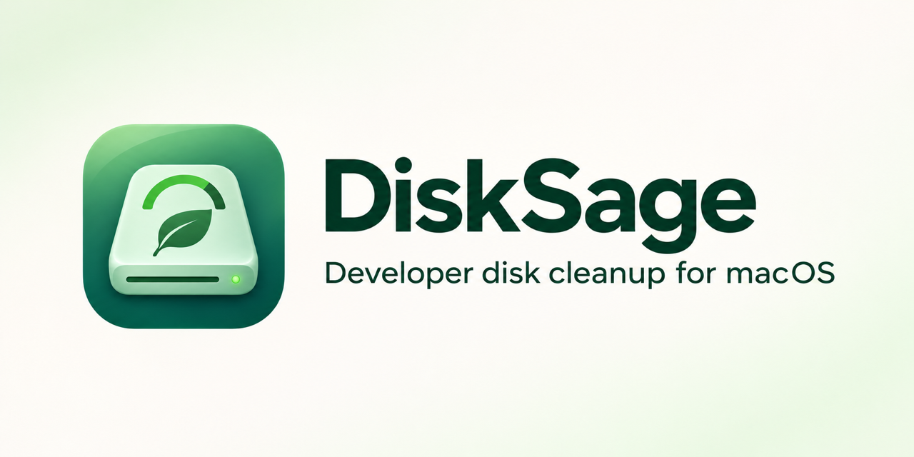

# DiskSage



A native macOS menu-bar app for finding developer build artifacts and caches,
reviewing cleanup decisions, and seeing exactly what was removed.

Use the rule-based scanner on its own, ask Claude, Codex, Apple on-device, or
Ollama for metadata-only advice, or connect an agent through MCP. The local
scanner and deletion policy remain in control of filesystem access.

[Quick start](#quick-start) · [Cleanup controls](#cleanup-controls) ·
[Agent choices](#agent-choices) · [MCP setup](#connect-claude-code-codex-or-another-mcp-client) ·
[Development](#development)

> Deletion is permanent: items do not go to the Trash. Low-disk automatic cleanup
> is enabled by default at **15 GiB**. Use the review-only launch option below
> if you want to inspect candidates before allowing background cleanup.

## What you get

- A menu-bar dashboard with disk capacity, cleanup estimates by category, and
  recent activity.
- Searchable, resizable Review and History windows, with risk explanations and
  deletion scope beside each candidate.
- Explicit confirmations for manual deletion, including selections hidden by
  filters. Cancel scanning or advice requests without losing the current list.
- Progress for up to four independent cleanup targets, immediate removal of
  successful rows, and retained failures with explanations.
- Local cleanup history and rotating logs recording what was attempted and when.
- Optional advisors and agent tools, with separate consent and cleanup controls.

## Quick start

### Requirements

- **Run:** macOS 14 or later.
- **Build:** Xcode 27 is the tested toolchain; SwiftPM resolves dependencies.
- **Optional advisors:** see [Agent choices](#agent-choices). No advisor is required
  to scan, review, or clean files.

### Build and open

```sh
git clone https://github.com/Abdo-codes/DiskSage.git
cd DiskSage
./Scripts/build-app.sh release
```

For a **review-only first launch**, disable low-disk automation before opening:

```sh
defaults write com.abdoeaita.DiskSage automaticCleanupEnabled -bool false
```

Then open the app:

```sh
open .build/release/DiskSage.app
```

Click the menu-bar drive icon, scan, and choose **Review items**. Reopening
DiskSage from Applications also reveals the dashboard. To use launch at login or
connect external agents, copy the built app to `/Applications/DiskSage.app`.

Local builds are ad-hoc signed, not Developer ID signed or notarized. The tagged
release workflow packages an app ZIP and SHA-256 checksum; a notarized installer
is not part of the current build pipeline.

## What DiskSage scans

Each scan shows up to **100 of the largest validated candidates**. Inaccessible,
empty, symlinked, disallowed, or running-executable targets are excluded.

| Location | Classification | Scope |
| --- | --- | --- |
| Xcode DerivedData | Low risk | Generated contents; parent folder remains |
| Project `.build` folders under `~/Developer` | Low risk | Entire generated folder |
| Generic project `build` folders under `~/Developer` | Needs review | Entire folder, only after manual selection |
| npm package cache and per-user Bazel output cache | Low risk | Cache folder |
| Child folders of `~/Library/Caches` and `~/.cache` | Low risk, with caveat below | Selected cache folder |
| Xcode Archives | Sensitive | Archives and dSYMs inside the archive folder |
| Simulator devices | Sensitive | All simulator devices, including installed apps and data |

**Low risk is a classification, not a guarantee that every tool uses its cache
correctly.** Some tools keep non-regenerable state in cache directories. Review
those candidates before allowing unattended cleanup. Archives, simulator devices,
and generic `build` folders are excluded from low-disk and agent cleanup.

## Cleanup controls

| Mode | How it starts | Confirmation |
| --- | --- | --- |
| Manual selection | Select items in Review, then **Delete Selected** | Always |
| Clean now | **Clean Low-Risk Items…** in the dashboard or menus | Always; scans first if needed |
| Low-disk automation | Startup and hourly capacity checks | No additional prompt for low-risk targets |
| Agent-requested cleanup | MCP tool or an explicitly enabled built-in advisor | Depends on **Agent Tools → Cleanup requests** |
| Scheduled folders | Daily, weekly, or once at a chosen time | Custom folder contents require explicit authorization when configured |

Configure startup, low-disk automation, and the threshold in
**Settings → General & Safety**. The default threshold is **15 GiB**. Automatic
cleanup runs a fresh scan and rechecks enablement, threshold, and available space
before deleting. Its preflight scan can be cancelled.

In Review, use search and risk filters to narrow the list. **Select Visible Low
Risk** preserves hidden selections; **Clear All** clears them too. The footer
counts hidden selections, and confirmation lists every selected target.

Once deletion starts, it finishes under the application-owned coordinator.
Closing a window or disconnecting an agent does not stop it; quitting is blocked
until the run finishes. Independent targets run concurrently, overlapping targets
retain their order, and simulator cleanup runs alone. Large trees can take time
because macOS must unlink their entries individually.

### Scheduled folders

Open **Settings → Schedules → Add schedule**. Choose a generated build/cache
folder and a daily, weekly, or one-time cleanup time. Low-risk mode is the default.
To clean another folder, choose **All folder contents** and explicitly authorize
permanent deletion. Each run removes the folder's contents while keeping the
folder itself. Symlinks are not followed, and replaced folders need new authorization.

Schedules have independent enable switches, next-run times, and last results;
completed deletions appear as **Scheduled** in History and the local logs. They
do not depend on the low-disk threshold. DiskSage must remain running; enable
launch at login for unattended use. Due times are checked every 30 seconds.
After sleep or downtime, each missed schedule runs once when the app is free,
then advances to its next occurrence. A running manual or agent operation delays
scheduled work. An occurrence is recorded before cleanup starts, so restarting
cannot repeat it. No schedules are created or enabled by default.

| Shortcut | Action |
| --- | --- |
| Command-1 | Open Review |
| Command-comma | Open Settings |
| Command-W | Close the current window |

## Agent choices

Choose a provider in **Settings → Agent**. Advanced executable paths and model
IDs are available for CLI providers; Claude also offers model presets.

| Provider | Requirements | Where metadata is processed |
| --- | --- | --- |
| Claude | Claude Code CLI installed and signed in | Through your existing Claude account |
| Codex | Codex CLI installed and signed in | Through your existing Codex account |
| Apple on-device | Compatible Mac, macOS 26+, Apple Intelligence enabled and model ready | On this Mac through Foundation Models |
| Ollama | Service at `localhost:11434` and a selected text model | Local models stay on-device; **Cloud** models use a remote provider |

Each remote-capable provider has separate metadata consent. Approving one does
not approve the others. Requests contain random candidate IDs, categories, sizes,
risk levels, and generic reasons—not paths, project names, file contents, or logs.
DiskSage does not store an API key or download Ollama models.

CLI detection only confirms that an executable exists. It does not verify sign-in,
quota, or provider availability. Unavailable configurations show setup guidance;
Apple never silently falls back to a remote provider.

Advisors have no host filesystem tools. Claude runs without built-in/MCP tools,
user/project customizations, or persistent sessions. Codex uses an ephemeral
read-only sandbox. Every response must cover the scanned IDs exactly once;
invalid or cancelled responses leave the selection unchanged. Advice requests
have a 90-second timeout and can be cancelled.

By default, built-in advisors only recommend. Enabling **Agent Tools → Allow
built-in advisors to request cleanup** permits a structured host cleanup request
under the same agent policy described below. The app still validates the request
and performs a fresh low-risk scan.

## Connect Claude Code, Codex, or another MCP client

Keep the GUI app open. After installing it at `/Applications/DiskSage.app`, use
**Settings → Agent Tools** to copy a setup command, or run:

```sh
claude mcp add --transport stdio --scope user disksage -- '/Applications/DiskSage.app/Contents/MacOS/DiskSage' --mcp
codex mcp add disksage -- '/Applications/DiskSage.app/Contents/MacOS/DiskSage' --mcp
```

Start a new client session to discover the tools. For another MCP client, choose
**stdio**, use the app executable as the command, and pass `--mcp` as its argument.
The stdio process forwards requests to the GUI coordinator over a private,
same-user Unix socket. Server readiness does not mean a client is connected.

**Settings → Agent Tools → Cleanup requests** has three policies:

- **Confirm in DiskSage** — the default; review and approve each cleanup.
- **Disabled** — reject cleanup requests; status and scanning remain available.
- **Allow low-risk cleanup** — authorized requests can permanently delete
  low-risk targets without another prompt.

This policy is separate from low-disk automation and metadata consent.
See the [complete MCP tool contract](docs/MCP.md) for all 26 tools and examples.

| Tool | Arguments | Result |
| --- | --- | --- |
| `get_status` | `{}` | Current free space, aggregate counts, busy state, and policy |
| `scan` | `{"request_id":"<UUID>"}` | Starts a read-only scan and returns a job |
| `clean_low_risk` | `{"request_id":"<UUID>"}` | Fresh scan, then cleanup under the configured policy |
| `get_job` | `{"request_id":"<UUID>"}` | Progress or completion for that job |

Use a fresh UUID for each new operation. Retry the same action with its original
UUID to retrieve its existing job without duplicating work. Busy requests are
rejected, not queued; retry them later with the same UUID. Scan and low-risk cleanup
tools do not accept paths or risk overrides. Schedule tools accept explicit folder
configuration under the same authorization rules as Settings.

Poll `get_job` until a terminal phase: `succeeded`, `warnings`, `failed`, or
`cancelled`. `awaitingConfirmation` requires user action in DiskSage. Acceptance
is not proof of deletion. Tool replies carry totals, timestamps, and sanitized
failures. Connected MCP clients can inspect paths, schedules, settings, history,
and logs through the review tools; built-in advisors still receive metadata only.

The last 100 jobs are retained for the current app session. The last 200 completed
schedule mutations are durably retained across restart and cannot be replayed to
restore an older configuration. An unknown ID
after restart or eviction is not proof that cleanup ran. Check history before
starting another request. Client disconnection does not cancel active deletion.

## History, measurements, and safety

History shows completed runs, individual results, and timestamps. **Open log
folder** reveals `~/Library/Logs/DiskSage/cleanup.jsonl`. Logs include trigger,
paths, item starts/results, and run summaries. They rotate at **5 MiB**, retain one
previous file, remain local, and are restricted to the current macOS user.

An item start without a finish means its outcome is unknown. A failure may occur
after partial removal. If logging fails, no new targets are scheduled; authorized
workers finish and the app reconciles their results.

Candidate sizes are estimates of allocated space, not a partition of disk usage.
Available capacity follows macOS important-use capacity and may include purgeable
space. Shared files, delayed reclamation, and other apps affect the observed
change. Review labels its retained value **Available space immediately after
cleanup**; the dashboard shows current capacity.

Scanner and agent targets are checked against a local allowlist before deletion.
Custom scheduled folders use separate, explicit folder authorization, checked
again immediately before deletion; they do not expand the scanner or agent allowlist.
Descriptor-relative deletion rejects symlink swaps, changed identities, and
mounted-filesystem boundaries. Targets under `.git`, broad roots, unauthorized
paths, and the running executable tree are refused. Built-in advisor output cannot
introduce a filesystem path or bypass the host cleanup policy.
See [SECURITY.md](SECURITY.md).

## Troubleshooting

| Symptom | What to check |
| --- | --- |
| Claude reports a usage limit | Wait for the limit to reset or select another advisor; signing in again does not reset quota |
| Claude reports missing/expired authentication | Run `claude auth login`, then retry |
| Ollama cannot be reached | Start Ollama and refresh models in Agent settings |
| Ollama returns HTTP 404/410 | Refresh models or choose another model; a listed cloud model can still be unavailable upstream |
| Ollama returns HTTP 401/403 or 429 | Check its sign-in or usage limit; consider another available model |
| MCP cannot reach DiskSage | Open the GUI app and verify the configured executable path |
| Deleted estimates and free-space change differ | Check completion timestamps and current dashboard capacity; reclamation is not necessarily immediate |

## Development

```sh
swift test
swift run DiskSage
```

The default suite uses controlled dependencies and disposable filesystem fixtures.
Live provider checks, a full-machine scan, and the parallel benchmark are opt-in;
a green default suite does not establish live account or model availability.

```sh
DISKSAGE_LIVE_APPLE_TEST=1 swift test --filter appleModelCompletesARealBatchedReview
DISKSAGE_LIVE_CLAUDE_TEST=1 swift test --filter claudeCompletesRealSyntheticReview
DISKSAGE_LIVE_CODEX_TEST=1 swift test --filter codexCompletesRealSyntheticReview
DISKSAGE_LIVE_OLLAMA_MODEL='<installed-model>' swift test --filter ollamaCompletesRealSyntheticReview
```

Live advisor tests send synthetic metadata directly to the provider. Provider
quotas, authentication, downloads, and upstream availability can affect them.

A single application-owned TCA `AppFeature` store owns scans, advice, confirmation,
cleanup, monitoring, and MCP jobs. `DiskSageClient`, operation IDs, `TestStore`,
controlled streams, and `TestClock` cover dependency behavior and stale-response
races. `AppModel` is a temporary view adapter; AppKit owns native window placement,
while review filters and settings retain their current local state/preferences.
Irreversible cleanup effects remain owned by the persistent root store.

The icon master is [Resources/AppIcon.png](Resources/AppIcon.png).
`Scripts/build-icon.sh` produces the macOS ICNS representations; the app build
includes the icon and SwiftPM resource bundles before signing.

## Contributing and license

See [CONTRIBUTING.md](CONTRIBUTING.md) for development and cleanup-location
proposals. New locations must be narrowly scoped, explicitly allowlisted, and
reviewed for user state that could be lost. Licensed under [MIT](LICENSE).
